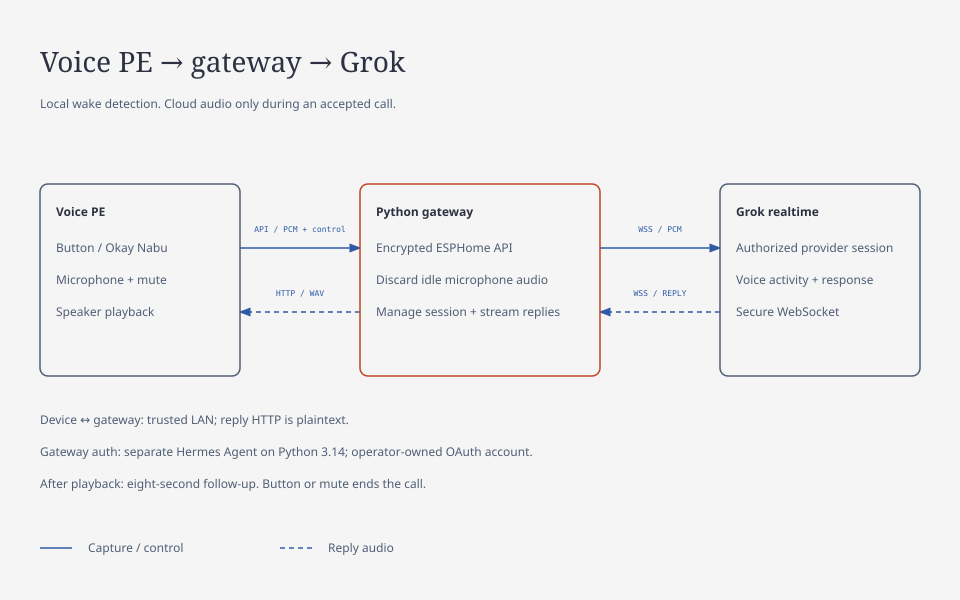

# grokvoice-for-esp32

Use a **Home Assistant Voice Preview Edition** speaker with a local Python gateway
and your own authorized Grok account. Say **“Okay Nabu”** or press the center button
to start a conversation. Replies stream back through the speaker. A Home Assistant
server is not required.

Use your own account with permission to access Grok realtime through OAuth.
See the [account requirements](docs/provider.md).

## How it works



[Diagram source](docs/architecture.html)

The speaker listens for **Okay Nabu** on the device. While connected and
unmuted, it also sends microphone audio to the gateway over the LAN. The
gateway discards idle audio. It starts sending audio to Grok when you start
a call with the wake word or button.

Speech during playback does not interrupt the reply. When playback ends, you
have eight seconds to ask a follow-up question. The mute switch ends the call.

## Get started

You need one Voice PE, a USB-C data cable and suitable USB power, a trusted
2.4 GHz Wi-Fi LAN, Git, Python 3.12 for ESPHome and the
gateway, and a separate Hermes Agent installation on Python 3.14 for sign-in
(Hermes also needs git-lfs and Node.js 26+).
Run the gateway on Linux. Use macOS or Linux to prepare the firmware.

```sh
git clone https://github.com/ytwytw/grokvoice-for-esp32.git
cd grokvoice-for-esp32
```

1. [Check account access and prepare Hermes](docs/provider.md). Keep the paths from sign-in for the gateway.
2. [Build the Voice PE firmware](docs/build-and-run.md). Create a unique device key and use the same key when you set up the gateway. The recipe uses USB for installation and updates.
3. [Install, check and start the gateway](docs/gateway.md). Run it on a computer the speaker can reach.
4. [Start your first conversation](docs/user-guide.md). The guide covers the button, wake word, mute switch and follow-up timing.
5. Optionally [add web search, X search or a remote MCP server](docs/tools.md) with `GROK_TOOLS_FILE`.

## Limitations

This version supports one speaker. Reply audio uses plaintext HTTP on a trusted
LAN; keep its port off the public internet. Speech cannot interrupt playback.
You must build the firmware yourself. There are no prebuilt images, custom wake
models or built-in reminders. Tools are optional and require a local configuration
file; see the [tools guide](docs/tools.md).

## Contributing and security

See [CONTRIBUTING.md](CONTRIBUTING.md) for development and [AGENTS.md](AGENTS.md)
for repository commands. [SECURITY.md](SECURITY.md) explains private reporting and
what to keep out of commits.

## License

The project's own code is licensed under [Apache-2.0](LICENSE). The firmware
YAML in `firmware/` is adapted from ESPHome and stays MIT, including this
project's changes.
Retained third-party materials keep their original notices; see [NOTICE](NOTICE)
and [source and dependency licenses](docs/provenance.md). Model redistribution
rights and permission to use the hosted provider are separate from this license.
